# 📓 Bitácora de Avance — Especialización IA Accenture (CCHIA)

> **Documento vivo de seguimiento, consultas, programas y estado del curso**  
> *Este documento se actualiza progresivamente a lo largo de las sesiones de trabajo con cada nueva consulta, código generado y avance por las unidades y gates del programa.*

---

## 📌 1. Ficha del Estudiante y Entorno del Proyecto

| Parámetro | Detalle |
| :--- | :--- |
| **Estudiante** | Sebastián Ayala (`sayala7` / `ayalaphysds`) |
| **Programa** | Especialización IA Accenture (Skillnest) |
| **Repositorio Remoto** | [`https://github.com/ayalaphysds/Curso-CCHIA.git`](https://github.com/ayalaphysds/Curso-CCHIA.git) |
| **Directorio Local** | `C:\Users\sayal\OneDrive\Desktop\Curso CCHIA\Curso-CCHIA` |
| **Proveedor LLM Recomendado** | Google Gemini API (o proveedor alternativo) |
| **Entorno de Ejecución** | Windows / PowerShell / VS Code / Python 3.12+ |
| **Fecha de Inicio** | Octubre 2026 |
| **Última Actualización** | 19 de Octubre de 2026 |

---

## 📍 2. ¿Dónde nos encontramos en el curso? (Estado Actual)

```mermaid
flowchart LR
    A["Módulo 1: Habilitación Técnica (20%)"] --> B["Gate 1 (Miniaplicación API)"]
    B --> C["Módulo 2: Componentes IA (35%)"]
    C --> D["Gate 2 (Servicio RAG + LangChain)"]
    D --> E["Módulo 3: Integración Profesional (45%)"]
    E --> F["Gate 3 Capstone (End-to-End)"]

    style A fill:#2563eb,stroke:#1d4ed8,stroke-width:2px,color:#ffffff
    style B fill:#f59e0b,stroke:#d97706,stroke-width:2px,color:#ffffff
    style C fill:#4b5563,stroke:#374151,stroke-width:1px,color:#ffffff
    style D fill:#4b5563,stroke:#374151,stroke-width:1px,color:#ffffff
    style E fill:#4b5563,stroke:#374151,stroke-width:1px,color:#ffffff
    style F fill:#4b5563,stroke:#374151,stroke-width:1px,color:#ffffff
```

> ### 🟢 Estado Actual:
> - **Módulo Activo:** **Módulo 1 — Habilitación Técnica** (Peso: 20% | 46 horas | 11 Bloques)
> - **Unidad Actual:** **U1.2 Setup técnico: terminal, Git, entorno Python y cliente HTTP**
> - **Bloque Actual:** **Bloque 4 — Variables de entorno y primera petición HTTP autenticada [Actividad Core]**
> - **Punto Exacto en U1.2:**
>   - ✅ *Completado:* Bloque 2 finalizado: Repositorio base formalmente commiteado.
>   - ✅ *Completado:* Bloque 3 finalizado: Entorno virtual `.venv` creado, librerías (`requests`, `python-dotenv`) instaladas, dependencias fijadas en `requirements.txt` y script de diagnóstico `src/verificar_entorno.py` validado.
>   - 🟡 *Paso Inmediato (Bloque 4):* Configurar variables de entorno (`.env` vs `.env.example`) y ejecutar la primera petición HTTP autenticada a la API de IA (Actividad Core entregable de la U1.2).

---

## 🗺️ 3. Mapa de Avance del Programa

### 🛠️ MÓDULO 1: Habilitación Técnica (20% de la nota) — *EN CURSO*
*Objetivo: Sentar bases técnicas sólidas (Git, Python modular, variables de entorno, seguridad, prompt estructurado) para la miniaplicación de consumo vía API.*

- [x] **U1.1 Alineación estratégica y perfil de egreso**
  - [x] Diagnóstico técnico y mapa de módulos, gates y cinturones.
  - [x] El punto de llegada: qué vas a tener construido al terminar.
  - [x] *Actividad Core:* Ficha de alineación técnica y elección de ruta.
- [ ] **U1.2 Setup técnico: terminal, Git, entorno Python y cliente HTTP**
  - [x] Bloque 2: Entorno completo de cero a API y por qué los secretos no van al repo.
  - [x] Bloque 2: *Actividad práctica:* Inicializa tu repositorio y haz tu primer commit [Completado y commiteado].
  - [x] Bloque 3: Réplica guiada del setup completo (entorno virtual `.venv`, `requirements.txt`) [Completado y validado].
  - [ ] Bloque 4: Variables de entorno (`.env`, `.gitignore`) `📍 [ESTAMOS AQUÍ]`.
  - [ ] Bloque 4: Disparo a la API desde Postman / Thunder Client / requests.
  - [ ] Bloque 4: *Actividad core:* Ejecuta tu primera petición autenticada de prueba.
- [ ] **U1.3 Python aplicado para integración con IA**
  - [ ] Bloque 5: *Actividad práctica:* Primer módulo Python de consumo de servicios externos (`functions`, `json`).
  - [ ] Bloque 5: Manejo de errores de red inducidos a propósito.
  - [ ] Bloque 6: Refactorización a funciones modulares y reutilizables en el repo.
  - [ ] Bloque 7: Excepciones (`try-except`), validación de entradas y rúbrica de calidad de código.
  - [ ] Bloque 7: *Actividad core:* Incorpora excepciones, validación y commit de avance.
- [ ] **U1.4 Fundamentos de IA generativa y arquitectura de aplicaciones**
  - [ ] Bloque 8: Tokens, ciclo request-response y cálculo de costos en vivo.
  - [ ] Bloque 8: *Actividad práctica:* Diagrama la arquitectura de tu miniaplicación.
  - [ ] Bloque 9: Criterios para elegir entre modelos candidatos (costo, latencia, escala).
  - [ ] Bloque 9: *Actividad core:* Documentación de la decisión de arquitectura en el repositorio.
- [ ] **U1.5 Prompt engineering profesional inicial**
  - [ ] Bloque 10: Prompts de sistema vs conversación y forzado de salida JSON estructurada.
  - [ ] Bloque 10: *Actividad core:* Banco de prompts y validación de consistencia.
- [ ] **U1.6 Gate 1 — Habilitación técnica**
  - [ ] Bloque 11: Repaso de rúbrica del Gate 1 y las tres oportunidades.
  - [ ] Bloque 11: Ensayo en vivo: clonar, instalar dependencias y ejecutar sin ayuda.
  - [ ] Bloque 11: *Actividad core / Sumativa:* **Rendición y entrega formal de Gate 1**.

---

### 🤖 MÓDULO 2: Construcción de componentes IA (35% de la nota) — *PENDIENTE*
- [ ] U2.1 Consumo avanzado de APIs y pipelines de texto
- [ ] U2.2 Orquestación con LangChain y modelos de lenguaje
- [ ] U2.3 Agentes inteligentes con herramientas (Tools & Function Calling)
- [ ] U2.4 RAG (Retrieval-Augmented Generation) y bases de datos vectoriales
- [ ] U2.5 Personalización y fine-tuning / observabilidad y seguridad
- [ ] **Gate 2: Integración y orquestación de servicios IA (Entrega modular completa)**

---

### 🚀 MÓDULO 3: Integración profesional (45% de la nota) — *PENDIENTE*
- [ ] U3.1 Diseño funcional y arquitectura del proyecto final
- [ ] U3.2 Exposición de servicios con FastAPI
- [ ] U3.3 Contenerización con Docker
- [ ] U3.4 Integración end-to-end, QA y matrices de prueba/riesgos
- [ ] U3.5 Despliegue, documentación técnica y demo ejecutiva
- [ ] **Gate 3: Capstone Project — Aplicación IA End-to-End para Producción**

---

## 🎯 4. Checklist Crítico: Criterios No Compensables (Gate 1)

Para aprobar el **Gate 1** (y acceder a la calificación mínima de 80% y optar al Cinturón), es obligatorio cumplir estos 4 puntos críticos:

| Criterio Crítico | Requisito | Estado | Evidencia / Verificación |
| :--- | :--- | :---: | :--- |
| **1. Código ejecutable** | La aplicación corre de punta a punta sin excepciones no capturadas. | ⏳ Pendiente | Pendiente desarrollo en U1.3 |
| **2. Entorno reproducible** | `requirements.txt` documentado y ejecutable en cualquier máquina con `pip install -r requirements.txt`. | ✅ Cumplido | Entorno `.venv` creado; librerías fijadas en `requirements.txt` |
| **3. Credenciales protegidas** | El archivo `.env` está en `.gitignore`. Nunca se commitea la API key real. | ⏳ En proceso | `.gitignore` configurado; verificar con `git status` |
| **4. Consumo exitoso de API** | La petición recibe respuesta HTTP 200 con payload válido del modelo. | ⏳ Pendiente | Pendiente prueba en U1.2 Bloque 4 |

---

## 💬 5. Registro Cronológico de Consultas y Preguntas

| ID | Fecha | Módulo / Tema | Consulta / Pregunta del Usuario | Respuesta / Solución Brindada | Estado |
| :---: | :---: | :---: | :--- | :--- | :---: |
| **C-001** | 19-10-2026 | Gestión del Curso | Creación de una bitácora de avance viva para registrar consultas, preguntas, programas y ubicación del curso. | Se analizó el repositorio git y plan de estudios (Skillnest - Accenture), se diseñó la estructura de la bitácora con mapa de unidades, gates, rúbrica, tablas de programas y registro de sesiones. | ✅ Resuelto |
| **C-002** | 19-10-2026 | U1.2 Setup técnico | Consulta explícita: ¿En qué parte exacta de la U1.2 nos encontramos? | Se analizó la unidad en sus 3 bloques (B2: Repo/Commit, B3: Entorno Virtual/Dependencias, B4: Variables de entorno y Primera petición HTTP). Estamos en el cierre de la Actividad Práctica del Bloque 2 (falta armar estructura `src/`, `docs/`, `tests/`, `.gitignore` y commit), listos para avanzar a Bloque 3 y Bloque 4. | ✅ Resuelto |
| **C-003** | 19-10-2026 | U1.2 Bloque 2 | Explicación de por qué la Lección 2 se considera completada. | La Lección 2 ("Cómo armar en vivo un entorno completo, de cero a API") es demostrativa y referencial (`Hecho: Ver`). El texto estipula que el alumno solo debe observar y comprender el flujo global sin ejecutar código aún, pasando la acción práctica a la actividad siguiente ("Inicializa tu repositorio"). | ✅ Resuelto |
| **C-004** | 19-10-2026 | U1.2 Bloque 2 | Verificación de archivos traídos desde disco duro externo (Plantilla ZIP y PDFs). | Se verificó que los 40 PDFs y el ZIP de la plantilla corresponden exactamente al curso. Se identificaron correcciones estructurales: extraer la plantilla en la raíz del repo de código y reubicar la carpeta pesada de PDFs fuera de `Curso-CCHIA` para cumplir la rúbrica del Gate 1. | ✅ Resuelto |
| **C-005** | 19-10-2026 | U1.2 Bloque 2 | Reorganización y extracción de documentos del archivo ZIP en la carpeta particular de la lección. | Se crearon las carpetas organizadas en `Material de Estudio\`, se extrajeron los archivos de la plantilla base en la lección U1.2 (`Plantilla Repositorio Base`), y se desplegó la estructura requerida en la raíz de `Curso-CCHIA` dejando el repositorio listo para el primer commit. | ✅ Resuelto |
| **C-006** | 19-10-2026 | U1.2 Bloque 2 | Registro del commit formal de inicialización con la estructura base del repositorio. | Se versionaron y commitearon formalmente los archivos de la plantilla base (`src/`, `docs/`, `tests/`, `requirements.txt`, `README.md`, `.gitignore`, `.env.example`, `BITACORA_DE_AVANCE.md`) con el mensaje oficial `"Estructura base del repositorio"` (Commit `15b54e7`), empujando los cambios a GitHub. Bloque 2 completado exitosamente. | ✅ Resuelto |
| **C-007** | 19-10-2026 | Entorno y Herramientas | Consulta: ¿Se puede realizar el curso de la CCHIA empleando Antigravity en lugar de VS Code? | Sí, totalmente viable y ventajoso. Antigravity está construido sobre el ecosistema Code-OSS (VS Code), por lo que comparte terminal, extensiones y gestión de Git. Lo que evalúa el programa son los entregables en GitHub y la ejecución reproducible en terminal, no el editor utilizado. | ✅ Resuelto |
| **C-008** | 19-10-2026 | U1.2 Bloque 3 | Creación y uso eficiente de entornos virtuales, y validación mediante scripts comparativos. | Se creó el entorno virtual `.venv`, se instalaron `requests` y `python-dotenv`, se congeló en `requirements.txt`, y se construyó el programa `src/verificar_entorno.py` para demostrar empíricamente el aislamiento entre el entorno virtual y el global. | ✅ Resuelto |
| **C-009** | 19-10-2026 | U1.2 Bloque 3 | Error `CommandNotFoundException` al ejecutar `.\.venv\Scripts\Activate.ps1`. | El error se produjo porque la terminal estaba abierta en la carpeta raíz `Curso CCHIA` y no dentro del repositorio `Curso-CCHIA` (donde reside `.venv`). Se resolvió explicando la navegación con `cd Curso-CCHIA` y la selección del intérprete en Antigravity. | ✅ Resuelto |
| **C-010** | 19-10-2026 | U1.2 Bloque 3 | Cómo crear y gestionar 2 programas simples con versiones diferentes de librerías usando entornos separados. | Se explicó el problema del choque de dependencias y la solución mediante 2 entornos aislados (`venv_a` y `venv_b`) ejecutando versiones distintas de un mismo paquete sin interferencias. | ✅ Resuelto |
| **C-011** | 19-10-2026 | U1.2 Bloque 3 | Error `[Errno 2] No such file or directory: app.py` en app_antigua. | El usuario siguió correctamente los pasos de creación de carpeta, `.venv`, instalación de versión antigua (`urllib3==1.26.18`) y `requirements.txt`. El error se debió a que faltaba crear el archivo `app.py` en dicha carpeta antes de invocarlo. Se crearon `app.py` en `app_antigua` y `app_moderna`, comprobando la coexistencia de versiones. | ✅ Resuelto |
| **C-012** | 19-10-2026 | Git y Versionamiento | Consulta: ¿Todo lo que coloque en `.gitignore` no será contemplado por Git y GitHub? | Se detalló la regla general (ignora archivos no rastreados) y la regla de oro/excepción: si un archivo ya fue commiteado antes de añadirlo a `.gitignore`, Git continuará rastreándolo a menos que se use `git rm --cached`. Se vinculó con la protección de secretos (`.env`) del Gate 1. | ✅ Resuelto |
| **C-013** | 19-10-2026 | U1.2 Bloque 4 | Inicio del Bloque 4: Variables de entorno y primera petición HTTP autenticada. | Creación de `.env` a partir de `.env.example`, confirmación de exclusión en `.gitignore` (`git check-ignore -v .env`), y diseño del script de verificación y consumo `src/probar_conexion_api.py`. | ⏳ En Progreso |

---

## 💻 6. Registro de Programas, Scripts y Artefactos de Código

| ID | Fecha | Archivo / Componente | Lenguaje / Tipo | Módulo / Unidad | Propósito / Funcionalidad | Estado |
| :---: | :---: | :---: | :---: | :---: | :--- | :---: |
| **PRG-001** | 19-10-2026 | [`BITACORA_DE_AVANCE.md`](file:///c:/Users/sayal/OneDrive/Desktop/Curso%20CCHIA/Curso-CCHIA/BITACORA_DE_AVANCE.md) | Markdown | General | Registro vivo del progreso del curso, consultas, programas generados y rúbricas. | ✅ Activo |
| **PRG-002** | 19-10-2026 | [`src/verificar_entorno.py`](file:///c:/Users/sayal/OneDrive/Desktop/Curso%20CCHIA/Curso-CCHIA/src/verificar_entorno.py) | Python | U1.2 Bloque 3 | Diagnóstico de entorno Python, verificación de aislamiento de `.venv` y comprobación de librerías instaladas. | ✅ Probado |
| **PRG-003** | 19-10-2026 | [`src/probar_conexion_api.py`](file:///c:/Users/sayal/OneDrive/Desktop/Curso%20CCHIA/Curso-CCHIA/src/probar_conexion_api.py) | Python | U1.2 Bloque 4 | Petición HTTP autenticada a Gemini API vía `requests`, comprobación de status 200 y generación de evidencia en `docs/`. | ⏳ Listo para prueba |

---

## 📅 7. Historial de Sesiones de Trabajo

### Sesión 1 — 19 de Octubre de 2026
- **Objetivo de la sesión:** Inicialización del sistema de bitácora y sincronización del estado del curso.
- **Acciones realizadas:**
  - Inspección del repositorio local `Curso-CCHIA`.
  - Análisis del historial de commits (`2c985e0` v1 con material curricular y `3275661` v2).
  - Extracción y mapeo del plan de estudios de la *Especialización IA Accenture*: 3 Módulos, 21 Unidades, 47 Bloques, 3 Gates y sistema de cinturones.
  - Creación del documento formal `BITACORA_DE_AVANCE.md` en el repositorio y directorio de trabajo.
- **Próximos pasos acordados:**
  - Continuar con la Unidad **U1.2: Setup técnico** (estructurar el repositorio, entorno virtual `.venv`, archivo `.gitignore` para secretos y script de prueba de API HTTP).

---

## ⚙️ 8. Protocolo de Actualización de la Bitácora
1. **Tras cada consulta o pregunta técnica:** Agregar una fila a la tabla de **Consultas y Preguntas** con la respuesta o conclusión.
2. **Tras generar o modificar un script/programa:** Agregar o actualizar la fila correspondiente en la tabla de **Programas y Artefactos de Código**.
3. **Al completar una actividad, bloque o unidad:** Marcar la casilla correspondiente con `[x]` en el **Mapa de Avance** y actualizar el indicador `📍 [ESTAMOS AQUÍ]`.
4. **Alcanzar un Gate:** Verificar previamente los 4 criterios no compensables y registrar el resultado de la evaluación.
