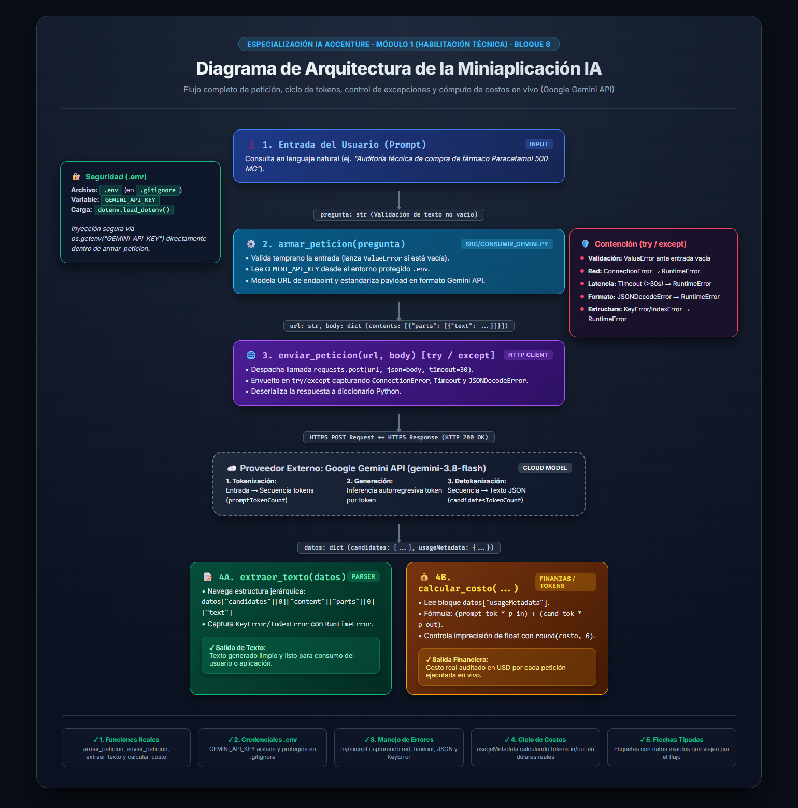

# 🏥 Miniaplicación de Consumo de IA — Especialización en IA Accenture (CCHIA)

[](https://www.python.org/)
[](LICENSE)
[](docs/decision-arquitectura.md)
[](tests/)

> **Proyecto Oficial de Habilitación Técnica (Gate 1)**  
> **Estudiante:** Sebastián Eduardo Ayala Vásquez (`sayala7` / `ayalaphysds`)  
> **Repositorio Remoto:** [`https://github.com/ayalaphysds/Curso-CCHIA.git`](https://github.com/ayalaphysds/Curso-CCHIA.git)

---

## 📌 1. Descripción del Proyecto

Esta miniaplicación implementa un **módulo modular y blindado para el consumo de modelos generativos vía API REST (Google Gemini API)**, aplicado al caso de uso de **auditoría de compras públicas y adquisiciones farmacéuticas (CENABAST / ChileCompra)**.

El sistema resuelve la evaluación de ofertas de medicamentos mediante prompts de sistema estructurados, contención integral de fallos de red/timeout/JSON, cálculo de costos monetarios en vivo a partir de metadatos de tokens (`usageMetadata`) y validación estricta de esquemas JSON con tipos (`responseSchema`).

---

## 🏗️ 2. Arquitectura de la Solución

El flujo técnico completo se ilustra en el siguiente diagrama de arquitectura (elaborado en el Bloque 8):



### Componentes Clave:
1. **`armar_peticion`:** Valida entradas, lee credenciales desde `.env` y construye URL + payload con `systemInstruction` y `generationConfig`.
2. **`enviar_peticion`:** Despacha la llamada HTTP POST vía `requests` con timeout controlado y contención `try/except`.
3. **`extraer_texto`:** Extrae el contenido textual limpio desde la estructura jerárquica de `candidates`.
4. **`calcular_costo`:** Calcula el costo exacto en dólares según los tokens de entrada y salida reportados en `usageMetadata`.
5. **`parsear_respuesta_json`:** Remueve bloques markdown y valida la presencia obligatoria de las claves requeridas.

---

## 📋 Contrato de Interfaz del JSON de Salida (Downstream Interface Contract)

> **Respuesta a la retroalimentación del evaluador:**  
> *"Documentar en el README el contrato de interfaz del JSON de salida para facilitar su consumo downstream."*

Este servicio de auditoría técnica farmacéutica expone una interfaz estrictamente tipada y validada mediante `responseSchema` de Gemini API y el parser de contención `parsear_respuesta_json`. Los sistemas consumidores downstream (tales como microservicios de compras públicas, canales de notificación, pipelines ETL o módulos de orquestación RAG en Gate 2) tienen garantizada la estructura y semántica descrita a continuación.

---

### A. Esquema Formal JSON Schema (Draft 2020-12 / OpenAPI 3.1)

```json
{
  "$schema": "https://json-schema.org/draft/2020-12/schema",
  "title": "ContratoSalidaAuditoriaCenabastGate1",
  "description": "Contrato formal de interfaz de salida estructurada JSON para el servicio de auditoría de compras públicas farmacéuticas CENABAST (Gate 1).",
  "type": "object",
  "properties": {
    "sobreprecio_detectado": {
      "type": "boolean",
      "description": "Indica si el precio unitario ofertado excede el umbral de tolerancia respecto a la mediana histórica del catálogo CENABAST."
    },
    "desviacion_pct": {
      "type": "number",
      "description": "Magnitud porcentual de desviación relativa de la oferta respecto a la mediana histórica: ((precio_ofertado - mediana) / mediana) * 100.",
      "minimum": -100.0
    },
    "recomendacion": {
      "type": "string",
      "description": "Acción resolutiva aconsejada para el analista de compras o el workflow licitatorio downstream.",
      "enum": ["adjudicar", "negociar", "rechazar"]
    },
    "dictamen": {
      "type": "string",
      "description": "Fundamentación técnica concisa (1 o 2 oraciones) que respalda la recomendación para fines de auditoría, informe legal y trazabilidad pública.",
      "minLength": 10,
      "maxLength": 500
    }
  },
  "required": [
    "sobreprecio_detectado",
    "desviacion_pct",
    "recomendacion",
    "dictamen"
  ],
  "additionalProperties": false
}
```

---

### B. Diccionario de Datos de la Interfaz

| Campo | Tipo JSON | Tipo Python | Requerido | Valores Permitidos / Restricciones | Descripción Semántica y Regla de Negocio CENABAST |
| :--- | :---: | :---: | :---: | :--- | :--- |
| `sobreprecio_detectado` | `boolean` | `bool` | **Sí** | `true` \| `false` | Bandera booleana de alerta temprana. Es `true` cuando el precio ofertado excede la mediana de mercado en más del umbral de tolerancia (15%) o supera la dispersión histórica (CV). Es `false` en ofertas conformes o con ahorro. |
| `desviacion_pct` | `number` | `float` | **Sí** | Número real (`float`) con 1 o 2 decimales.<br>Restricción: `minimum: -100.0`. | Desviación porcentual relativa frente a la mediana de catálogo: ((precio_ofertado - mediana) / mediana) * 100. Valores negativos representan ahorro fiscal; valores positivos indican sobrecosto respecto a la línea base. |
| `recomendacion` | `string` | `str` | **Sí** | `enum`: `["adjudicar", "negociar", "rechazar"]` | Acción resolutiva para el workflow licitatorio:<br>• `"adjudicar"`: Precio dentro de la banda histórica de tolerancia arancelaria.<br>• `"negociar"`: Sobreprecio moderado (típicamente entre 15% y 60%) donde procede solicitar ajuste o mejora de precio al proveedor.<br>• `"rechazar"`: Sobreprecio crítico (>60%) o riesgo insalvable de sobrecosto injustificado. |
| `dictamen` | `string` | `str` | **Sí** | Texto legible (`str`), longitud entre 10 y 500 caracteres (`minLength: 10`, `maxLength: 500`). | Síntesis ejecutiva y legal que sustenta el acta de evaluación o informe técnico ante el comité de compras de CENABAST / Mercado Público. |

---

### C. Ejemplos Representativos de Salida

#### Escenario 1: Sobreprecio Moderado — Negociación Arancelaria
*Caso de uso:* Oferta de Paracetamol 500 MG a $33.60 CLP vs mediana de $22.40 CLP (+50.0% de sobreprecio).
```json
{
  "sobreprecio_detectado": true,
  "desviacion_pct": 50.0,
  "recomendacion": "negociar",
  "dictamen": "El precio ofertado ($33.60 CLP) excede en un 50% la mediana histórica de catálogo ($22.40 CLP), justificando negociación arancelaria previa a la adjudicación."
}
```

#### Escenario 2: Oferta Conforme — Adjudicación Directa
*Caso de uso:* Oferta competitiva de Amoxicilina 500 MG a $18.20 CLP vs mediana de $19.00 CLP (-4.2% de desviación).
```json
{
  "sobreprecio_detectado": false,
  "desviacion_pct": -4.2,
  "recomendacion": "adjudicar",
  "dictamen": "El precio ofertado se sitúa un 4.2% bajo la mediana histórica y se encuentra dentro de la dispersión habitual de mercado; oferta técnica y económicamente admisible."
}
```

#### Escenario 3: Desviación Crítica — Rechazo Inmediato
*Caso de uso:* Oferta anómala de Insulina NPH a $14.500 CLP vs mediana de $6.720 CLP (+115.8% de sobreprecio).
```json
{
  "sobreprecio_detectado": true,
  "desviacion_pct": 115.8,
  "recomendacion": "rechazar",
  "dictamen": "El precio ofertado duplica la línea base histórica sin justificación logística demostrable; se aconseja desestimar la propuesta por sobreprecio crítico."
}
```

---

### D. Patrón de Consumo Downstream en Python (Pydantic v2)

Los módulos downstream pueden validar y deserializar de forma segura este JSON empleando el siguiente modelo tipado:

```python
from typing import Literal
from pydantic import BaseModel, Field, ValidationError

class ContratoAuditoriaCenabast(BaseModel):
    sobreprecio_detectado: bool = Field(
        ...,
        description="Flag booleano de detección de sobreprecio"
    )
    desviacion_pct: float = Field(
        ...,
        ge=-100.0,
        description="Desviación porcentual respecto a la mediana histórica (-100.0 a +inf)"
    )
    recomendacion: Literal["adjudicar", "negociar", "rechazar"] = Field(
        ...,
        description="Acción operacional recomendada"
    )
    dictamen: str = Field(
        ...,
        min_length=10,
        max_length=500,
        description="Fundamento técnico y legal para auditoría"
    )

def procesar_auditoria_downstream(payload_json: str) -> ContratoAuditoriaCenabast:
    """
    Función de consumo downstream para microservicios, pipelines ETL o flujos RAG en Gate 2.
    Valida y tipa fuertemente el payload producido por Gate 1.
    """
    try:
        resultado = ContratoAuditoriaCenabast.model_validate_json(payload_json)
        if resultado.sobreprecio_detectado:
            print(f"[ALERTA COMPRAS] Sobreprecio del {resultado.desviacion_pct}%: acción = '{resultado.recomendacion}'")
            print(f"[DICTAMEN] {resultado.dictamen}")
        else:
            print(f"[CONFORME] Oferta aprobada para adjudicación: {resultado.dictamen}")
        return resultado
    except ValidationError as err:
        raise ValueError(f"Fallo en contrato de interfaz downstream: {err}") from err
```

---

### E. Metadatos Operacionales Asociados (Costo y Tokens)

Junto con la respuesta del modelo, la función `calcular_costo()` de `src/consumir_gemini.py` reporta las métricas operacionales de cada transacción, extrayendo el nodo `usageMetadata` retornado por la API:
- **`promptTokenCount`**: Tokens consumidos por el prompt de auditoría y las instrucciones del sistema (típicamente ~80-120 tokens).
- **`candidatesTokenCount`**: Tokens generados en la respuesta estructurada JSON (típicamente ~40-70 tokens).
- **Costo USD en tiempo real**: Calculado según la tarifa oficial de Google Gemini 3.8 / 3.5 Flash:
  $$\text{Costo USD} = (\text{promptTokenCount} \times 0.000000075) + (\text{candidatesTokenCount} \times 0.000000300)$$
- **Impacto operacional**: Cada evaluación cuesta aproximadamente **$0.000020 - $0.000160 USD**, permitiendo auditar decenas de miles de ofertas mensuales con un presupuesto inferior a $5 USD.

---

## 📂 3. Estructura de la Macro-Carpeta Gate 1

```bash
Gate 1/
├── .env.example                           # Plantilla de variables de entorno para Gate 1
├── requirements.txt                       # Dependencias fijadas y reproducibles de Gate 1
├── README.md                              # Documentación con contrato de interfaz formal
├── main.py                                # Punto de entrada ejecutable de la miniaplicación
├── docs/                                  # Documentación técnica y evidencias
│   ├── diagrama_arquitectura.png          # Diagrama oficial del flujo técnico (Bloque 8)
│   ├── decision-arquitectura.md           # Registro formal de decisión de modelo (Bloque 9)
│   └── evidencia_peticion_autenticada.json# Evidencia de respuesta HTTP 200 OK (Bloque 4)
├── prompts/                               # Banco de prompts y validación (Bloque 10)
│   ├── banco.py                           # 3 prompts con systemInstruction y responseSchema
│   ├── test_consistencia.py               # Script de prueba de consistencia (3 repeticiones)
│   └── registro_resultados.json           # Registro de 100% de consistencia en salida JSON
├── src/                                   # Código fuente modular
│   ├── consumir_gemini.py                 # Módulo de integración principal blindado
│   ├── comparar_modelos.py                # Benchmark empírico de latencia y costos (Flash vs Pro)
│   ├── probar_conexion_api.py             # Script de validación de conexión inicial
│   └── verificar_entorno.py               # Diagnóstico de aislamiento de entorno virtual
└── tests/                                 # Suite de pruebas automatizadas
    ├── test_consumir_gemini.py            # 13 pruebas unitarias exhaustivas (100% passing)
    └── test_conexion.py                   # Prueba de contención de errores de red inducidos
```

---

## 💻 4. Instalación y Ejecución Limpia (Reproducibilidad)

Sigue estos pasos para clonar, configurar y ejecutar la aplicación desde cero en cualquier máquina:

### Paso 1: Clonar el Repositorio
```bash
git clone https://github.com/ayalaphysds/Curso-CCHIA.git
cd Curso-CCHIA
```

### Paso 2: Crear y Activar el Entorno Virtual

**En Windows (PowerShell):**
```powershell
python -m venv .venv
.\.venv\Scripts\Activate.ps1
```

**En Linux / macOS / WSL:**
```bash
python3 -m venv .venv
source .venv/bin/activate
```

### Paso 3: Instalar Dependencias
```bash
pip install -r requirements.txt
```

### Paso 4: Configurar Variables de Entorno
Copia la plantilla `.env.example` y crea tu archivo `.env`:

```bash
# Windows (PowerShell)
Copy-Item .env.example .env

# Linux / macOS
cp .env.example .env
```

Edita `.env` e introduce tu clave de API:
```env
GEMINI_API_KEY=tu_clave_real_aqui
```

> 🔒 **Seguridad garantizada:** El archivo `.env` está expresamente excluido del repositorio mediante `.gitignore` y nunca ha sido commiteado al historial de Git.

### Paso 5: Ejecutar la Miniaplicación

**Opción A (Desde la macro-carpeta `Gate 1/`):**
```bash
cd "Gate 1"
python main.py
```

**Opción B (Desde la raíz del repositorio):**
```bash
python "Gate 1/main.py"
```

**Salida esperada:**
```text
======================================================================
  ACCENTURE / CCHIA — MINIAPLICACIÓN IA (GATE 1: HABILITACIÓN TÉCNICA)
======================================================================

[1/4] Entorno y credenciales verificados correctamente (.env cargado).
[2/4] Construyendo petición con prompt de sistema y responseSchema...
[3/4] Enviando petición HTTP POST a Google Gemini API...
[4/4] Respuesta recibida y estructurada exitosamente:
----------------------------------------------------------------------
Respuesta del modelo: {"sobreprecio_detectado": true, ...}
----------------------------------------------------------------------
Datos JSON parseados e indexados:
  • sobreprecio_detectado: True
  • desviacion_pct: 50.0
  • recomendacion: negociar
  • dictamen: El precio ofertado excede en 50% la mediana histórica...

Costo real calculado en vivo: $0.000159 USD
----------------------------------------------------------------------
Proceso terminado sin errores.
```

---

## 🧪 5. Ejecución de la Suite de Pruebas Unitarias

Para validar automáticamente todos los componentes, validaciones tempranas, control de excepciones de red, esquemas y parseo de JSON:

**Opción A (Desde la macro-carpeta `Gate 1/`):**
```bash
cd "Gate 1"
python -m unittest discover tests
```

**Opción B (Desde la raíz del repositorio):**
```bash
python -m unittest discover -s "Gate 1/tests"
```

**Opción C (Invocación directa del módulo de pruebas):**
```bash
python "Gate 1/tests/test_consumir_gemini.py"
```

**Resultado:**
```text
.............
----------------------------------------------------------------------
Ran 13 tests in 1.750s

OK
```

---

## 📊 6. Banco de Prompts y Consistencia (Bloque 10)

Para verificar la consistencia del banco de prompts estructurados:
```bash
# Desde la carpeta Gate 1:
cd "Gate 1"
python prompts/test_consistencia.py

# O desde la raíz del repositorio:
python "Gate 1/prompts/test_consistencia.py"
```
*Tasa de éxito:* **100% de consistencia** (3/3 respuestas válidas en los 3 prompts) documentado en [`prompts/registro_resultados.json`](prompts/registro_resultados.json).

---

## 📋 7. Registro del Ensayo de Instalación Limpia (Bloque 11)

Conforme a la rúbrica del Gate 1, se ejecutó un ensayo completo de clonado e instalación desde cero en un directorio aislado:

- **Fecha de realización:** 20 de Octubre de 2026.
- **Entorno de prueba:** Carpeta aislada temporal (`prueba-gate1`), Windows 11 / PowerShell, Python 3.12.
- **Procedimiento probado:** `git clone` &rarr; `python -m venv` &rarr; `pip install -r requirements.txt` &rarr; `Copy-Item .env.example .env` &rarr; `python main.py`.
- **Hallazgos encontrados:** Ninguno. Todas las dependencias declaradas en `requirements.txt` se instalaron limpiamente sin requerir paquetes manuales.
- **Verificación de secretos:** Se ejecutó `git status` y `git log --all --oneline -- .env` confirmando que `.env` no aparece listado ni existe en ningún commit del historial.
- **Resultado del ensayo:** **Aprobado sin observaciones.** El proyecto corre de punta a punta de forma 100% autónoma y reproducible.

---

## 🎯 8. Checklist de Criterios No Compensables (Gate 1)

| Criterio Crítico No Compensable | Estado | Verificación / Evidencia |
| :--- | :---: | :--- |
| **1. Código ejecutable** | ✅ Cumplido | `main.py` corre de punta a punta sin tracebacks no capturados; suite con 13/13 tests OK. |
| **2. Entorno reproducible** | ✅ Cumplido | `requirements.txt` documentado y ejecutable con `pip install -r requirements.txt`. |
| **3. Credenciales protegidas** | ✅ Cumplido | `.env` protegido por `.gitignore`; historial limpio (`git log` sin rastros de secretos). |
| **4. Consumo exitoso de API** | ✅ Cumplido | Peticiones HTTP 200 recibiendo payloads válidos de Gemini API (`usageMetadata` y `candidates`). |

---
*Desarrollado para la Especialización en Inteligencia Artificial de Accenture.*
