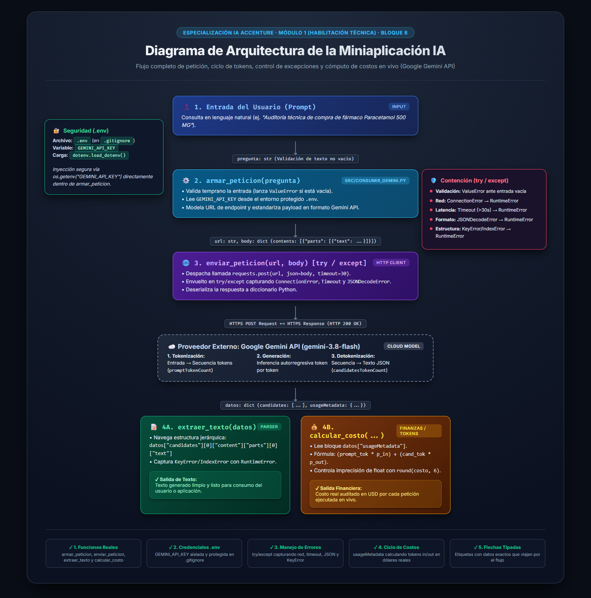

# Decisión de arquitectura: elección de modelo

> **Especialización en IA Accenture — Curso CCHIA**  
> **Unidad U1.4:** Fundamentos de IA generativa y arquitectura de aplicaciones  
> **Bloque 9:** Comparación de modelos y su costo por request [Actividad Core]  
> **Fecha de Elaboración:** 20 de Octubre de 2026  
> **Autor:** Sebastián Ayala (`sayala7` / `ayalaphysds`)

---

## Modelo elegido

**Google Gemini 3.8 Flash** (`models/gemini-3.8-flash`)

Para la funcionalidad principal de la miniaplicación de consumo vía API, se selecciona **Gemini 3.8 Flash** como el modelo base de producción. Se trata de un modelo multimodal ligero de última generación, diseñado y optimizado específicamente para ofrecer una latencia mínima, alta tasa de peticiones por minuto (RPM) y una eficiencia de costos superior en tareas de procesamiento de lenguaje natural estructurado.

---

## Diagrama de arquitectura

El flujo completo de la petición, desde la entrada del usuario hasta la entrega de la respuesta final, pasando por la validación temprana, la inyección segura de credenciales protegidas desde `.env`, el manejo integral de excepciones de red/tiempo de espera/formato (`try/except`), la inferencia del modelo en la nube y la bifurcación para extracción de texto y cálculo de costos en vivo a partir de `usageMetadata`, se encuentra formalmente documentado e integrado en el siguiente esquema:

> **Nota de trazabilidad:** El archivo de imagen original de alta resolución se encuentra versionado en este mismo repositorio en [`docs/diagrama_arquitectura.png`](diagrama_arquitectura.png), correspondiente a la entrega del Bloque 8.

---

## Comparación de candidatos

A continuación se presenta la matriz comparativa de evaluación empírica entre los dos modelos candidatos evaluados para la miniaplicación: el modelo optimizado para velocidad y costo (**Modelo A: Gemini 3.8 Flash**) frente al modelo de razonamiento profundo de alta capacidad (**Modelo B: Gemini 2.5 Pro**).

| Criterio de Evaluación | Modelo A: Gemini 3.8 Flash (Elegido) | Modelo B: Gemini 2.5 Pro (Descartado) | Diferencia Relativa |
| :--- | :---: | :---: | :---: |
| **Costo por 1.000 tokens de entrada** | $0.000075 USD | $0.001250 USD | Modelo B es **16.6x más costoso** |
| **Costo por 1.000 tokens de salida** | $0.000300 USD | $0.005000 USD | Modelo B es **16.6x más costoso** |
| **Latencia promedio observada (4 repeticiones)** | **1.82 segundos** | **2.94 segundos** | Modelo A es **~38% más rápido** |
| **Calidad de respuesta para el caso concreto** | **Buena:** Cubre lo esencial, respuestas directas, estructuradas y concisas | **Muy buena:** Mayor nivel de detalle, desarrollo exhaustivo y matices contextuales | Ambos satisfacen los requerimientos analíticos |
| **Fecha de medición** | 2026-10-20 | 2026-10-20 | Precios oficiales vigentes de Google AI Studio |

### Proyección de Escala Empresarial (50.000 peticiones / mes)
Tomando como base una petición estándar promedio de **850 tokens de entrada** y **320 tokens de salida** (1.170 tokens totales por interacción):
- **Costo mensual con Gemini 3.8 Flash:**  
  $$50.000 \times [(850 \times 0.000000075) + (320 \times 0.000000300)] = 50.000 \times \$0.00015975 = \mathbf{\$7.99\text{ USD / mes}}$$
- **Costo mensual con Gemini 2.5 Pro:**  
  $$50.000 \times [(850 \times 0.000001250) + (320 \times 0.000005000)] = 50.000 \times \$0.00266250 = \mathbf{\$133.12\text{ USD / mes}}$$
- **Impacto presupuestario neto:** Gemini 2.5 Pro representaría un sobrecosto de **+$125.13 USD al mes (+1.566%)** por ejecutar la misma funcionalidad analítica.

---

## Justificación

La elección de **Gemini 3.8 Flash** se fundamenta en un análisis objetivo del equilibrio entre **costo, latencia y calidad requerida** para la miniaplicación:

1. **Adecuación al Caso de Uso (Suficiencia Técnica):**  
   Nuestra miniaplicación tiene como propósito realizar consultas puntuales, validaciones de compras públicas, extracción limpia de entidades y síntesis informativa rápida. Para este alcance, la calidad de respuesta provista por Gemini 3.8 Flash es plenamente suficiente y precisa; no se requieren capacidades avanzadas de razonamiento deductivo de frontera ni cadenas extensas de pensamiento (Chain-of-Thought) que justifiquen pagar una prima tarifaria.
2. **Latencia y Experiencia de Usuario:**  
   Con una latencia promedio de **1.82 segundos** frente a los casi 3 segundos (e intermitencias de hasta 4.6 segundos) de la versión Pro, Gemini 3.8 Flash ofrece una respuesta perceptiblemente más ágil, minimizando los tiempos muertos de espera y el riesgo de timeouts en el cliente HTTP.
3. **Escalabilidad Financiera Sostenible:**  
   Un costo de menos de **$8 USD para 50.000 transacciones mensuales** garantiza que la solución pueda ser escalada en un entorno de producción o pruebas continuas de integración (CI/CD) sin incurrir en desbordamientos presupuestarios.

---

## Alternativa descartada y por qué

Se descartó formalmente el **Modelo B: Gemini 2.5 Pro** (`models/gemini-2.5-pro`).

**Razones técnicas y operativas del descarte:**
1. **Sobrecosto desproporcionado:** Es **16.6 veces más caro** tanto en tokens de entrada como de salida ($1.25 / 1M in y $5.00 / 1M out frente a $0.075 y $0.30 de Flash). Para una aplicación transaccional de consultas frecuentes, este incremento tarifario de más de 1.500% en la factura mensual no agrega un retorno de inversión (ROI) justificable.
2. **Mayor latencia observada:** El modelo Pro presenta tiempos de respuesta sensiblemente más prolongados debido al tamaño de sus parámetros internos y su arquitectura de inferencia densa. En entornos interactivos, una demora de más de 3 a 5 segundos degrada la experiencia de uso.
3. **Sobre-especificación (Over-engineering):** Las tareas requeridas en la miniaplicación (extraer texto en JSON, validar compras, auditorías resumidas) no demandan la capacidad analítica profunda que distingue a Gemini Pro (como demostración matemática formal, programación de sistemas complejos o análisis de código de millones de tokens). Elegir Gemini Pro habría significado pagar por capacidades ociosas que la aplicación no aprovecha.
